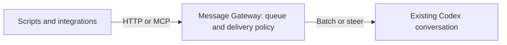
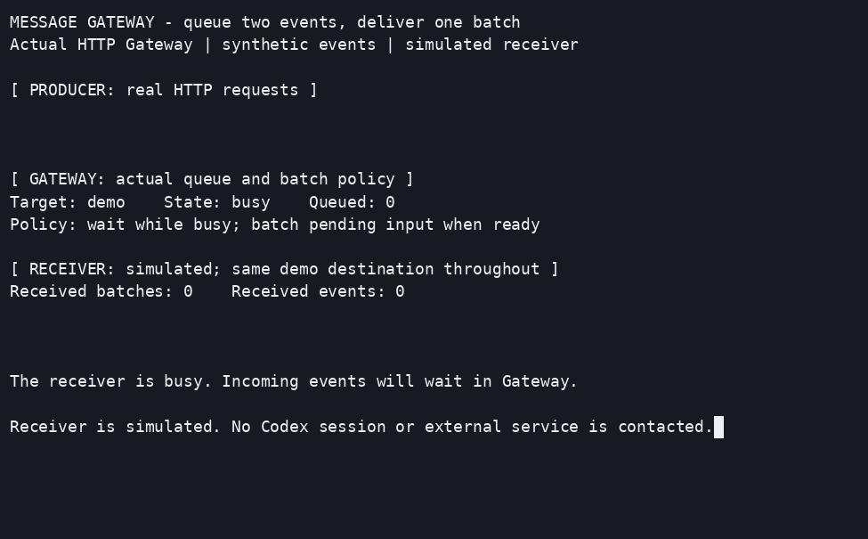

# Message Gateway

**Bring external events into your running Codex conversation.**

Message Gateway accepts text and JSON from scripts and services over HTTP or
MCP. A separate in-memory queue for each destination lets you batch events
while the receiver is busy, or add messages to an active turn with interactive
delivery. The included native adapter supports Codex on Linux.

- Connect producers through one local HTTP or MCP interface.
- Choose queued batches or interactive delivery for each destination.
- Keep complete original content separate from short display previews.

Actual HTTP gateway and queue; synthetic build events and a simulated receiver. [Reproduce the recording](docs/development.md#usage-demo).

## Get started

Follow [the setup guide](docs/getting-started.md) to install the receiver skill,
bind a conversation, configure authentication and submit an event. Gateway
does not interpret source content or start another Codex process.

## Add Telegram

[Telegram Bot Relay](https://github.com/dmitry-ra/telegram-bot-relay) can feed
Telegram updates into Gateway and provide Codex's outgoing reply tools.
Relay handles permissions, archives and attachments; Gateway handles delivery.
Follow the single
[end-to-end cookbook](https://github.com/dmitry-ra/telegram-bot-relay/blob/main/docs/codex.md).
Both services work independently.

## Documentation

| Need | Read |
| --- | --- |
| Install, run, send and stop | [Getting started](docs/getting-started.md) |
| Configuration, API, delivery and diagnostics | [Reference](docs/reference.md) |
| Develop, test and reproduce the demo | [Development](docs/development.md) |
| Test evidence and compatibility | [Validation](docs/validation.md) |
| Operate this repository with an agent | [Operator skill](.agents/skills/operate-message-gateway/SKILL.md) |

This is an experimental local service: queues are volatile, and acceptance
does not prove that a receiver processed or answered a message. See
[delivery limits](docs/reference.md#delivery-results-and-limits).

Licensed under the [MIT License](LICENSE).
